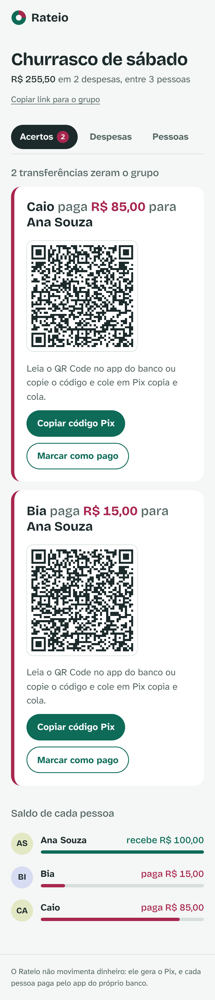
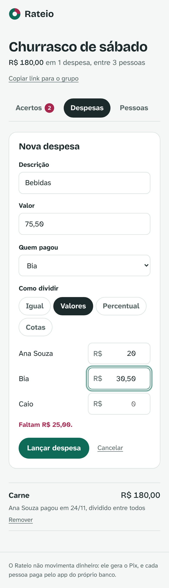

# Rateio

[](https://github.com/johnatantech/rateio/actions/workflows/ci.yml)
[](https://codespaces.new/johnatantech/rateio)

Divisor de despesas em grupo que calcula **quem deve para quem com o menor número de transferências** e gera o **Pix copia e cola** de cada acerto, com o valor exato e a chave de quem vai receber.

Feito para a casa, a viagem ou o churrasco: lança as despesas, vê os saldos, paga o Pix e pronto.

**Demo:** <!-- cole aqui o link da Vercel, ex.: https://rateio-johnatan.vercel.app -->

> A API da demo roda no plano gratuito do Render e hiberna após um tempo sem uso. Na primeira abertura, o app avisa e aguarda o servidor acordar, o que pode levar até um minuto.

<p>
  
  &nbsp;&nbsp;
  
</p>

## O que já funciona

| Recurso | Detalhe |
|---|---|
| **Quatro formas de dividir** | Partes iguais, por valores, por percentual e por cotas (ex.: casal = 2) |
| **Saldos** | Quanto cada pessoa pagou, consumiu e tem a receber ou a pagar |
| **Acertos simplificados** | No máximo *n − 1* transferências para *n* pessoas; dívidas em ciclo se anulam |
| **Pix copia e cola** | Padrão BR Code do Banco Central, com valor, descrição e conferência por CRC16 |
| **Chaves Pix** | CPF, CNPJ (inclusive alfanumérico), e-mail, telefone e chave aleatória, com identificação automática do tipo e exibição mascarada |
| **App** | Angular, pensado para o celular e instalável como aplicativo (PWA): grupos, pessoas, despesas com as 4 formas de divisão, saldos e acertos com QR Code |
| **API REST** | Grupos, participantes, despesas, saldos, acertos e pagamentos, com documentação interativa |
| **Persistência** | Entity Framework Core com SQL Server (desenvolvimento) e PostgreSQL (demo), com migrations para os dois |
| **Demo pública** | App na Vercel, API no Render e banco no Neon, tudo em planos gratuitos |

## App

O app tem três abas por grupo:

- **Acertos:** cada transferência escrita como frase ("Caio paga R$ 85,00 para Ana"), com o **QR Code do Pix**, botão para copiar o código e para marcar como pago. Abaixo, o saldo de cada pessoa em barras. Quando todos ficam quites, aparecem duas opções: **começar uma nova rodada** com as mesmas pessoas (bom para contas que se repetem) ou **excluir o grupo**.
- **Despesas:** lançamento com as quatro formas de divisão e **conferência ao vivo** ("Faltam R$ 25,00", "Os percentuais somam 90%"), antes de enviar.
- **Pessoas:** participantes com a chave Pix mascarada.

Os grupos abertos ficam lembrados no navegador, e o link do grupo pode ser copiado para mandar no WhatsApp. No celular, o app pode ser instalado na tela inicial.

## API


| Método | Rota | O que faz |
|---|---|---|
| `POST` | `/api/grupos` | Cria um grupo |
| `GET` | `/api/grupos/{id}` | Dados do grupo, participantes e total gasto |
| `DELETE` | `/api/grupos/{id}` | Exclui o grupo (só com todos quites) |
| `POST` | `/api/grupos/{id}/nova-rodada` | Apaga despesas e pagamentos e mantém as pessoas (só com todos quites) |
| `POST` | `/api/grupos/{id}/participantes` | Adiciona participante, com chave Pix opcional |
| `GET` `POST` | `/api/grupos/{id}/despesas` | Lista ou lança despesas |
| `DELETE` | `/api/grupos/{id}/despesas/{despesaId}` | Remove uma despesa |
| `GET` | `/api/grupos/{id}/saldos` | Saldo de cada participante |
| `GET` | `/api/grupos/{id}/acertos` | Transferências sugeridas, cada uma com seu Pix copia e cola |
| `GET` `POST` | `/api/grupos/{id}/pagamentos` | Lista ou registra acertos pagos |
| `GET` | `/health` | Saúde da API e do banco |

Exemplo de despesa dividida por cotas:

```json
POST /api/grupos/{id}/despesas
{
  "descricao": "Hotel",
  "pagoPorId": "…",
  "valor": 300.00,
  "divisao": {
    "tipo": "Cotas",
    "participantes": [
      { "participanteId": "…", "cotas": 2 },
      { "participanteId": "…", "cotas": 1 }
    ]
  }
}
```

Erros seguem o padrão **ProblemDetails** (RFC 9457): `400` para dado inválido (valor com fração de centavo, percentuais que não somam 100%, chave Pix inválida), `404` para grupo inexistente e `422` para regra violada (participante com nome repetido).

## Decisões técnicas

### Domínio

- **Dinheiro em centavos inteiros (`long`).** Em `double`, 0,1 + 0,2 não é exatamente 0,3. O tipo `Dinheiro` só aceita centavos exatos e rejeita frações como R$ 10,005.
- **Divisão pelo método dos maiores restos.** R$ 100,00 entre 3 pessoas vira R$ 33,34 + R$ 33,33 + R$ 33,33: cada um recebe a parte inteira e os centavos que sobram vão para as maiores frações, com desempate pela ordem. A soma sempre fecha e o resultado é determinístico.
- **Simplificação de dívidas com algoritmo guloso.** Casa repetidamente o maior devedor com o maior credor. Cada passo zera ao menos uma pessoa, o que garante no máximo *n − 1* transferências. Encontrar o mínimo absoluto é NP-difícil (equivale a dividir o grupo em subconjuntos de soma zero), então o guloso é a escolha prática: rápido, previsível e próximo do ótimo.
- **BR Code implementado do zero.** Campos no formato ID + tamanho + valor do padrão EMV e CRC16-CCITT no final. O teste principal gera **exatamente o exemplo oficial do Manual de Padrões para Iniciação do Pix**, caractere por caractere.
- **Fechamento só com todos quites.** Nova rodada e exclusão apagam dados para todos que têm o link, então o domínio recusa as duas operações enquanto houver acerto pendente, com a mensagem de quantos faltam. A regra fica no domínio, não só no botão da tela.
- **Testes por propriedade.** 300 grupos aleatórios (semente fixa, reproduzíveis) verificam que os saldos somam zero, que nunca passam de *n − 1* transferências e que, depois dos acertos, todos ficam zerados.

### App

- **Nenhum cálculo de dinheiro no navegador.** Saldos, acertos e divisões vêm sempre da API; depois de qualquer alteração, o app recarrega os dados. O front só confere a divisão ao vivo para orientar quem está digitando.
- **Valores digitados do jeito brasileiro.** `12,50`, `1.234,56` e `R$ 90` são aceitos; frações de centavo são recusadas antes de chegar à API.
- **Angular moderno:** componentes standalone, signals, novo controle de fluxo (`@if`, `@for`), rotas com carregamento sob demanda e testes com Vitest.
- **Fontes empacotadas no app** (Bricolage Grotesque e Atkinson Hyperlegible Next, criada para leitura fácil), sem requisição a serviços externos.
- **Acessibilidade:** foco visível, alvos de toque de 44 px ou mais, rótulos em todos os campos, mensagens de erro anunciadas por leitores de tela e animações desligadas para quem prefere menos movimento.
- **Proxy de desenvolvimento:** `/api` é encaminhado para a API .NET pelo `proxy.conf.json`, sem CORS em desenvolvimento. Em produção, o endereço da API vem de `environment.production.ts`.
- **Servidor gratuito que hiberna:** leituras são repetidas automaticamente enquanto a API acorda, com um aviso na tela. Gravações nunca são repetidas sozinhas, para não duplicar uma despesa. O app também "acorda" a API assim que abre, enquanto a pessoa ainda está lendo a tela.
- **PWA:** service worker do Angular guarda só os arquivos do app; os dados vêm sempre da API, para ninguém ver saldo desatualizado.

### API e banco

- **O domínio não conhece o banco.** As tabelas têm modelos de persistência próprios, e o `RepositorioDeGrupos` reconstrói o `Grupo` a partir delas. Toda alteração segue o mesmo caminho: carrega o grupo, aplica a operação no domínio (que valida as regras) e só então grava. Nenhuma regra fica duplicada na API ou em SQL.
- **O banco como última barreira.** `CHECK` constraints garantem valores positivos e pagamento entre pessoas diferentes, e um índice único impede dois participantes com o mesmo nome no grupo, inclusive em requisições simultâneas (o erro de unicidade vira `422`).
- **Valores em `bigint` (centavos)** no banco e em reais com 2 casas na API, convertidos na borda.
- **Chave Pix mascarada nas listagens.** O valor completo só aparece dentro do Pix copia e cola, que precisa dele para funcionar (LGPD).
- **Testes de integração com SQL Server de verdade.** Cada classe de teste sobe a API em memória com um banco exclusivo, criado pelas migrations e apagado no final. Sem banco disponível, os testes são pulados com o motivo explicado. No CI, um passo extra falha o build se algum teste for pulado.
- **Migrations sob controle.** O CI roda `dotnet ef migrations has-pending-model-changes` e falha se alguém alterar o modelo sem gerar a migration. As migrations são aplicadas automaticamente só em desenvolvimento.
- **Dois bancos, um modelo.** SQL Server no desenvolvimento (stack de mercado corporativo) e PostgreSQL na demo, porque há plano gratuito sem cartão. O banco é escolhido por configuração (`Banco__Provedor`); as migrations de cada um ficam em projetos separados, e o CI roda os testes de integração **nos dois bancos** e confere as migrations de ambos.
- **Exclusão em ordem explícita, numa transação.** Em vez de confiar nas cascatas do banco (o PostgreSQL resolve a ordem de forma diferente do SQL Server, e um teste de integração pegou isso), o repositório apaga pagamentos, divisões, despesas, pessoas e grupo nessa ordem, dentro da estratégia de execução do EF Core.
- **Diferenças tratadas explicitamente:** as constraints usam a sintaxe de cada banco, o erro de unicidade é reconhecido nos dois (códigos 2601/2627 e 23505) e a conexão aceita tanto o formato chave=valor quanto a URL que o Neon fornece.
- **Proteção da demo pública:** limite de 60 gravações por minuto por IP (leituras livres), com resposta `429` em ProblemDetails. Atrás do proxy do Render, o IP real vem do cabeçalho `X-Forwarded-For`.
- **Imagem Docker enxuta e sem privilégios:** build em duas etapas, restauração em camada separada para aproveitar cache e execução com usuário comum. O CI compila a imagem a cada push.
- **Mesmo código em todo lugar.** A string de conexão vem de configuração: o Codespace e o CI sobem os bancos em container e definem `ConnectionStrings__Rateio`; na demo, ela fica nas variáveis de ambiente do Render, nunca no repositório.

## Como executar

### No navegador, sem instalar nada

Clique em **Abrir no GitHub Codespaces** no topo. O ambiente sobe com **.NET 10 e SQL Server** prontos e conectados (configuração em [`.devcontainer`](.devcontainer)).

Em um terminal, suba a API:

```bash
dotnet run --project src/Rateio.Api           # API em http://localhost:5080
```

Em outro terminal, suba o app:

```bash
cd src/Rateio.Web
npm start                                     # app em http://localhost:4200
```

Abra a porta **4200** pela aba **Portas** do VS Code. A documentação da API fica em `/scalar` na porta **5080**, e o arquivo [`Rateio.Api.http`](src/Rateio.Api/Rateio.Api.http) tem um roteiro de requisições prontas.

Testes:

```bash
dotnet test                                   # 373 testes: domínio e integração com o banco
cd src/Rateio.Web && npm run test:ci          # 31 testes do app
```

### Na sua máquina

Pré-requisitos: [.NET 10 SDK](https://dotnet.microsoft.com/download), [Node.js 22](https://nodejs.org) e um SQL Server (Docker, LocalDB ou instância local). Defina a variável `ConnectionStrings__Rateio` e rode os mesmos comandos. Com Docker e a extensão Dev Containers do VS Code, **Reopen in Container** recria o ambiente do Codespace.

## Publicar a demo

Tudo em planos gratuitos, sem cartão de crédito.

**1. Banco no [Neon](https://neon.tech).** Crie um projeto (região São Paulo, se disponível) e copie a *connection string*. Ela pode ser colada como está, no formato `postgresql://…`.

**2. API no [Render](https://render.com).** *New → Web Service*, escolha este repositório, ambiente **Docker** (o `Dockerfile` está na raiz) e plano **Free**. Em *Environment*, defina:

| Variável | Valor |
|---|---|
| `ConnectionStrings__Rateio` | a connection string do Neon |
| `Cors__Origens__0` | o endereço do app na Vercel, sem barra no final |

Em *Health Check Path*, use `/health`. O provedor PostgreSQL, as migrations na inicialização e o suporte ao proxy já vêm configurados no `Dockerfile`.

**3. App na [Vercel](https://vercel.com).** Coloque o endereço da API em `src/Rateio.Web/src/environments/environment.production.ts`, faça o push e importe o repositório na Vercel com **Root Directory** `src/Rateio.Web`. O `vercel.json` já define build, pasta de saída e rotas.

Cada push na `main` republica a API e o app.

## Estrutura

```
rateio/
├── src/
│   ├── Rateio.Dominio/             # regras de negócio, sem dependências
│   ├── Rateio.Infra/               # EF Core, repositório e migrations do SQL Server
│   ├── Rateio.Infra.Postgres/      # migrations do PostgreSQL (demo)
│   ├── Rateio.Api/                 # endpoints, contratos e tratamento de erros
│   └── Rateio.Web/                 # app Angular
├── tests/
│   ├── Rateio.Dominio.Tests/       # 354 testes, incluindo propriedades e exemplo do BCB
│   └── Rateio.Api.Tests/           # 19 testes: integração com banco real (SQL Server e PostgreSQL)
├── .devcontainer/                  # .NET 10, Node.js 22 e SQL Server para Codespaces
├── .github/workflows/ci.yml        # .NET com SQL Server e PostgreSQL, Angular e imagem Docker
├── Dockerfile                      # imagem da API para o Render
├── docs/
├── Directory.Build.props           # avisos tratados como erro em todos os projetos
└── Rateio.slnx
```

## Roteiro

- [x] **Semana 1:** domínio (divisão, saldos, simplificação, Pix) com testes e CI
- [x] **Semana 2:** API ASP.NET Core + SQL Server com testes de integração
- [x] **Semana 3:** app Angular (grupos, despesas, saldos e QR Code)
- [x] **Semana 4:** PWA instalável, PostgreSQL, proteção da API, Docker e configuração da demo pública

## Importante

- O Rateio **não movimenta dinheiro**: ele só gera o código, e o pagamento é feito no app do banco de cada pessoa. Como o Pix copia e cola é estático, o app não sabe se o pagamento aconteceu, por isso os acertos são marcados como pagos manualmente.
- **Acesso por link, sem login:** o identificador de cada grupo é um UUID aleatório (122 bits), e a API não tem nenhuma rota que liste grupos. Na prática, só quem recebeu o link encontra o grupo, como num documento compartilhado por link. Quem tem o link pode consultar e alterar o grupo.
- A demo é pública: use dados fictícios e não cadastre chaves Pix reais de outras pessoas.

## Licença

[MIT](LICENSE)

## Autor

**Johnatan Flores** · [GitHub](https://github.com/johnatantech) · [LinkedIn](https://www.linkedin.com/in/johnatan-flores-67595a221/)
