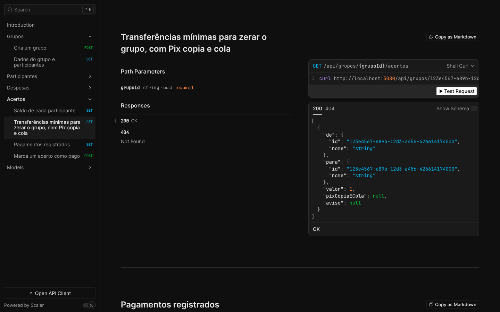

# Rateio

[](https://github.com/johnatantech/rateio/actions/workflows/ci.yml)
[](https://codespaces.new/johnatantech/rateio)

Divisor de despesas em grupo que calcula **quem deve para quem com o menor número de transferências** e gera o **Pix copia e cola** de cada acerto, com o valor exato e a chave de quem vai receber.

Feito para a casa, a viagem ou o churrasco: lança as despesas, vê os saldos, paga o Pix e pronto.

> 🚧 **Em construção.** Já funcionam o **núcleo de regras de negócio** e a **API REST com SQL Server**, cobertos por 363 testes. O app em Angular vem a seguir (veja o [roteiro](#roteiro)).



## O que já funciona

| Recurso | Detalhe |
|---|---|
| **Quatro formas de dividir** | Partes iguais, por valores, por percentual e por cotas (ex.: casal = 2) |
| **Saldos** | Quanto cada pessoa pagou, consumiu e tem a receber ou a pagar |
| **Acertos simplificados** | No máximo *n − 1* transferências para *n* pessoas; dívidas em ciclo se anulam |
| **Pix copia e cola** | Padrão BR Code do Banco Central, com valor, descrição e conferência por CRC16 |
| **Chaves Pix** | CPF, CNPJ (inclusive alfanumérico), e-mail, telefone e chave aleatória, com identificação automática do tipo e exibição mascarada |
| **API REST** | Grupos, participantes, despesas, saldos, acertos e pagamentos, com documentação interativa |
| **Persistência** | SQL Server com Entity Framework Core e migrations |

## API

| Método | Rota | O que faz |
|---|---|---|
| `POST` | `/api/grupos` | Cria um grupo |
| `GET` | `/api/grupos/{id}` | Dados do grupo, participantes e total gasto |
| `POST` | `/api/grupos/{id}/participantes` | Adiciona participante, com chave Pix opcional |
| `GET` `POST` | `/api/grupos/{id}/despesas` | Lista ou lança despesas |
| `DELETE` | `/api/grupos/{id}/despesas/{despesaId}` | Remove uma despesa |
| `GET` | `/api/grupos/{id}/saldos` | Saldo de cada participante |
| `GET` | `/api/grupos/{id}/acertos` | Transferências sugeridas, cada uma com seu Pix copia e cola |
| `GET` `POST` | `/api/grupos/{id}/pagamentos` | Lista ou registra acertos pagos |
| `GET` | `/health` | Saúde da API e do banco |

Exemplo de despesa dividida por cotas:

```json
POST /api/grupos/{id}/despesas
{
  "descricao": "Hotel",
  "pagoPorId": "…",
  "valor": 300.00,
  "divisao": {
    "tipo": "Cotas",
    "participantes": [
      { "participanteId": "…", "cotas": 2 },
      { "participanteId": "…", "cotas": 1 }
    ]
  }
}
```

Erros seguem o padrão **ProblemDetails** (RFC 9457): `400` para dado inválido (valor com fração de centavo, percentuais que não somam 100%, chave Pix inválida), `404` para grupo inexistente e `422` para regra violada (participante com nome repetido).

## Decisões técnicas

### Domínio

- **Dinheiro em centavos inteiros (`long`).** Em `double`, 0,1 + 0,2 não é exatamente 0,3. O tipo `Dinheiro` só aceita centavos exatos e rejeita frações como R$ 10,005.
- **Divisão pelo método dos maiores restos.** R$ 100,00 entre 3 pessoas vira R$ 33,34 + R$ 33,33 + R$ 33,33: cada um recebe a parte inteira e os centavos que sobram vão para as maiores frações, com desempate pela ordem. A soma sempre fecha e o resultado é determinístico.
- **Simplificação de dívidas com algoritmo guloso.** Casa repetidamente o maior devedor com o maior credor. Cada passo zera ao menos uma pessoa, o que garante no máximo *n − 1* transferências. Encontrar o mínimo absoluto é NP-difícil (equivale a dividir o grupo em subconjuntos de soma zero), então o guloso é a escolha prática: rápido, previsível e próximo do ótimo.
- **BR Code implementado do zero.** Campos no formato ID + tamanho + valor do padrão EMV e CRC16-CCITT no final. O teste principal gera **exatamente o exemplo oficial do Manual de Padrões para Iniciação do Pix**, caractere por caractere.
- **Testes por propriedade.** 300 grupos aleatórios (semente fixa, reproduzíveis) verificam que os saldos somam zero, que nunca passam de *n − 1* transferências e que, depois dos acertos, todos ficam zerados.

### API e banco

- **O domínio não conhece o banco.** As tabelas têm modelos de persistência próprios, e o `RepositorioDeGrupos` reconstrói o `Grupo` a partir delas. Toda alteração segue o mesmo caminho: carrega o grupo, aplica a operação no domínio (que valida as regras) e só então grava. Nenhuma regra fica duplicada na API ou em SQL.
- **O banco como última barreira.** `CHECK` constraints garantem valores positivos e pagamento entre pessoas diferentes, e um índice único impede dois participantes com o mesmo nome no grupo, inclusive em requisições simultâneas (o erro de unicidade vira `422`).
- **Valores em `bigint` (centavos)** no banco e em reais com 2 casas na API, convertidos na borda.
- **Chave Pix mascarada nas listagens.** O valor completo só aparece dentro do Pix copia e cola, que precisa dele para funcionar (LGPD).
- **Testes de integração com SQL Server de verdade.** Cada classe de teste sobe a API em memória com um banco exclusivo, criado pelas migrations e apagado no final. Sem banco disponível, os testes são pulados com o motivo explicado. No CI, um passo extra falha o build se algum teste for pulado.
- **Migrations sob controle.** O CI roda `dotnet ef migrations has-pending-model-changes` e falha se alguém alterar o modelo sem gerar a migration. As migrations são aplicadas automaticamente só em desenvolvimento.
- **Mesmo código em todo lugar.** A string de conexão vem de configuração: o Codespace e o CI sobem o SQL Server em container e definem `ConnectionStrings__Rateio`.

## Como executar

### No navegador, sem instalar nada

Clique em **Abrir no GitHub Codespaces** no topo. O ambiente sobe com **.NET 10 e SQL Server** prontos e conectados (configuração em [`.devcontainer`](.devcontainer)).

```bash
dotnet test                                   # 363 testes, incluindo integração com o banco
dotnet run --project src/Rateio.Api           # API em http://localhost:5080
```

Com a API rodando, abra a aba **Portas** do VS Code, clique no globo da porta **5080** e acrescente `/scalar` ao endereço para usar a documentação interativa. O arquivo [`Rateio.Api.http`](src/Rateio.Api/Rateio.Api.http) tem um roteiro de requisições prontas.

### Na sua máquina

Pré-requisitos: [.NET 10 SDK](https://dotnet.microsoft.com/download) e um SQL Server (Docker, LocalDB ou instância local). Defina a variável `ConnectionStrings__Rateio` e rode os mesmos comandos. Com Docker e a extensão Dev Containers do VS Code, **Reopen in Container** recria o ambiente do Codespace.

## Estrutura

```
rateio/
├── src/
│   ├── Rateio.Dominio/             # regras de negócio, sem dependências
│   ├── Rateio.Infra/               # EF Core, migrations e repositório
│   └── Rateio.Api/                 # endpoints, contratos e tratamento de erros
├── tests/
│   ├── Rateio.Dominio.Tests/       # 351 testes, incluindo propriedades e exemplo do BCB
│   └── Rateio.Api.Tests/           # 12 testes de integração com SQL Server real
├── .devcontainer/                  # .NET 10 + SQL Server para Codespaces
├── .github/workflows/ci.yml        # build, migrations e testes com SQL Server em container
├── docs/
├── Directory.Build.props           # avisos tratados como erro em todos os projetos
└── Rateio.slnx
```

## Roteiro

- [x] **Semana 1:** domínio (divisão, saldos, simplificação, Pix) com testes e CI
- [x] **Semana 2:** API ASP.NET Core + SQL Server com testes de integração
- [ ] **Semana 3:** app Angular (grupos, despesas, saldos e QR Code)
- [ ] **Semana 4:** PWA instalável, compartilhamento por link, deploy e demo pública

## Importante

- O Rateio **não movimenta dinheiro**: ele só gera o código, e o pagamento é feito no app do banco de cada pessoa. Como o Pix copia e cola é estático, o app não sabe se o pagamento aconteceu, por isso os acertos são marcados como pagos manualmente.
- Nesta etapa a API **não tem autenticação**: quem conhece o identificador do grupo consegue consultá-lo e alterá-lo. O controle de acesso por link de compartilhamento está previsto para a semana 4.

## Licença

[MIT](LICENSE)

## Autor

**Johnatan Flores** · [GitHub](https://github.com/johnatantech) · [LinkedIn](https://www.linkedin.com/in/johnatan-flores-67595a221/)
